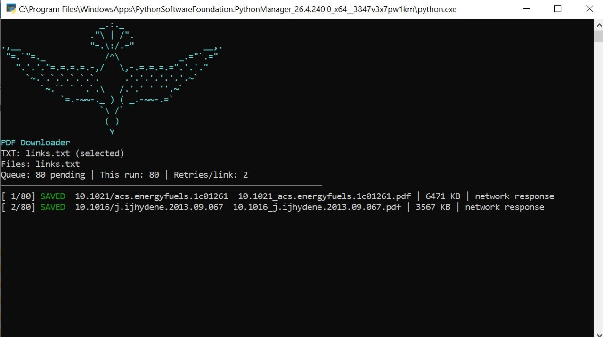
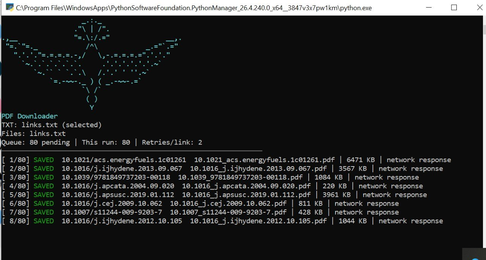

# DOI-PDF-Hunter

<div align="center">
  
  
  
</div>

<div align="center">
  <h3>Advanced DOI and Sci-Hub PDF downloader with smart link discovery.</h3>
</div>

A Python tool for extracting DOIs and paper URLs from text files, opening them in a real browser, and automatically discovering the final PDF file—even when the PDF is hidden behind JavaScript, blob URLs, or dynamically generated network responses.

<p align="center">
  
  
</p>

## Features

- Extracts DOI and URL entries from plain text files
- Visits Sci-Hub and related academic pages in a browser
- Detects PDFs hidden behind DOM, blob, and network responses
- Filters duplicate files using SHA-256 hashes
- Handles retries and temporary network issues gracefully
- Saves progress and failure logs for follow-up checks

## Contributors

<div align="center">
  <a href="https://github.com/nazakther805-alt">
    
  </a>
  <a href="https://github.com/Quincunx33">
    
  </a>
</div>

<p align="center">
  <strong>Maintainer:</strong> <a href="https://github.com/Quincunx33">Quincunx33</a><br>
  <strong>Contributor:</strong> <a href="https://github.com/nazakther805-alt">nazakther805-alt</a>
</p>

## Quick Start

```bash
git clone https://github.com/Quincunx33/DOI-PDF-Hunter.git
cd DOI-PDF-Hunter

python -m venv .venv
source .venv/bin/activate   # Linux/macOS
# .venv\Scripts\activate    # Windows

pip install playwright
python -m playwright install chromium
```

Create a file named `links.txt` in the project root:

```text
10.1038/s41586-020-00773-7
https://doi.org/10.1109/ICCV.2019.00027
```

Run:

```bash
python xtract_doi.py
```

## Notes

- Outputs are saved in the `downloads/` folder.
- Duplicate and skipped items are tracked automatically.
- Some sites may require a CAPTCHA or manual browser interaction.
- For extra logs, run:

```bash
PDF_VERBOSE=1 python xtract_doi.py
```

## Why use it?

This project helps when you have a set of DOI references, paper links, or raw academic text and want a faster way to turn them into downloadable PDFs without manual copy-paste and repeated checks.
